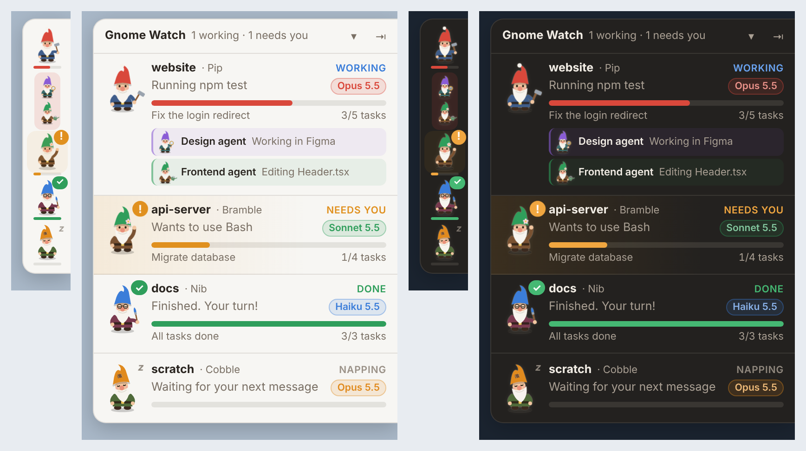
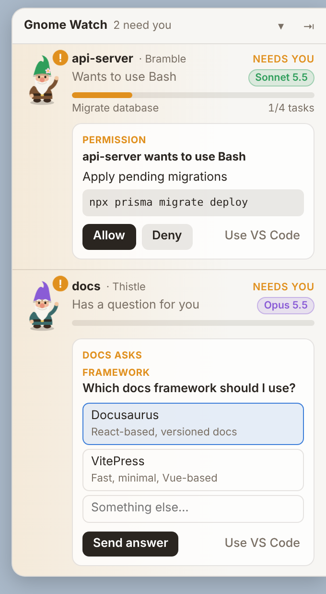
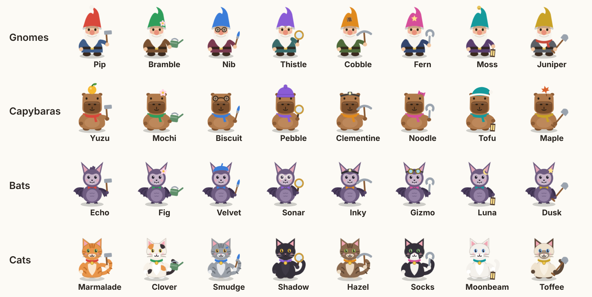

# Gnome Watch

**A little drawer on the edge of your screen that shows what your Claude Code agents are doing, as gnomes.**

Each agent gets its own character with a progress bar from its task list, the model it's running, and a status line. When an agent needs permission or asks you a question, you can answer right from the drawer without switching back to VS Code.



## Features

- **Slides out when you leave VS Code.** While VS Code is in front, Gnome Watch tucks into a slim tab on the right edge of your screen. Switch to another app and it slides out into the full panel. Click to expand or minimize it any time.
- **One character per agent.** Each agent has a gnome that works its own tool (hammer, watering can, paintbrush…), waves when it needs you, and naps when it's been quiet for a while. Each project folder always gets the same gnome, so you learn to recognize them.
- **Real progress.** The bar fills as the agent finishes items on its task list. Without a task list, it shows a "busy" shimmer.
- **Helpers, too.** Subagents (including your own from `.claude/agents`) appear as smaller characters under the agent that started them, each with its own status line.
- **Shows the model.** Each agent shows the model it's using, like *Opus 5.5*, and the label follows `/model` switches.
- **Answer without switching.** Allow or deny permission prompts, and answer Claude's multiple-choice questions (or type your own answer), right from the panel.
- **Character packs.** Gnomes, capybaras, bats or cats.
- **Light and dark mode.** Follows your system appearance.



## Character packs

Pick one from the menu-bar menu under **Character pack**. Every pack has the same eight roles, tools and animations, plus one special touch each: bats hang upside down to nap, and cats swish their tails.



## Requirements

- **macOS.** Windows and Linux mostly work too; see [Platform notes](#platform-notes).
- **Node.js 18 or later**
- **[Claude Code](https://docs.claude.com/en/docs/claude-code/overview)**: the CLI or the VS Code extension

## Install

```bash
git clone <this repo> gnome-watch
cd gnome-watch
npm install
npm run install-hooks
npm start
```

`npm run install-hooks` adds Gnome Watch's hooks to your user-level Claude Code settings (`~/.claude/settings.json`). It saves a backup first, keeps your other settings and hooks, and is safe to run again. **Restart any Claude Code sessions that were already open** so they pick up the hooks.

Keep the `gnome-watch` folder where it is after installing, because the hooks run a script inside it. If you switch Node versions (nvm, a Homebrew upgrade), run `npm run install-hooks` again.

### Build the app and start it at login (macOS)

```bash
npm run package:mac
mv "dist/Gnome Watch-darwin-arm64/Gnome Watch.app" /Applications/
```

On an Intel Mac, the folder is `Gnome Watch-darwin-x64`. Quit any copy you started with `npm start` (only one can run at a time), then open **Gnome Watch** from Applications. It lives in the menu bar with no Dock icon. Check **Start at login** in its menu.

After changing the code, run `npm run package:mac` again and replace the app.

## Using it

| You see | It means |
|---|---|
| Character working its tool | The agent is busy |
| Waving, with an orange `!` | It needs you: a permission prompt or a question |
| Eyes closed, green ✓ | Finished; your turn |
| `z` | Quiet for 20+ minutes, so it's napping |

- **Answer prompts** with *Allow* / *Deny*, or pick an option and press *Send answer*. **Use VS Code** hands that prompt back to Claude Code's normal dialog. While VS Code is in front, Gnome Watch never intercepts anything, so Claude Code works exactly as usual.
- **Click a character** in the expanded panel to open its project in VS Code.
- **Drag the title bar** to move the drawer up or down; it stays docked to the right edge.
- **⇥** minimizes the drawer and **▾** switches the panel to a compact view.

**The menu-bar menu** lets you choose:

- **When the drawer shows:** *Minimize in VS Code, expand when I leave* (the default), *Always expanded*, or *Hide*. *Hide* means you answer everything in VS Code.
- **Character pack**
- **Chime** when a character needs you
- **Start at login**
- **Open event log**

## How it works

```
Claude Code ──hook──▶ hook/gnome-hook.js ──HTTP on localhost, with a token──▶ Gnome Watch app
                                ◀── decision JSON (permissions and questions only) ──┘
```

Claude Code runs a small script at points in each session, such as starting, using a tool, finishing, or asking a question. The script passes the event to the app over a local connection.

- For **permission prompts and questions**, the app can hold the request until you answer in the panel, then send your answer back as the hook's decision.
- For **everything else**, the script returns immediately, so it never slows Claude down.

If the app isn't running, the hooks exit right away, as if they weren't installed.

| Path | What it does |
|---|---|
| `src/core.js` | Agent state, tasks, helpers, models, and holding and answering prompts |
| `src/server.js` | Local server. It writes its port and a random token to `~/.gnome-watch/server.json`. |
| `src/focus.js` | Detects when VS Code (or Cursor or Windsurf) is in front |
| `src/main.js` | Window, drawer behavior, menu-bar menu |
| `renderer/` | The UI (plain HTML/CSS/JS) |
| `renderer/packs/` | Character packs |
| `hook/gnome-hook.js` | The hook script Claude Code runs |
| `scripts/` | Install and uninstall the hooks |

### Privacy

Everything stays on your machine. The server only listens on `127.0.0.1` and requires a random token that changes on every launch. Nothing is sent anywhere else.

For troubleshooting, the app keeps a log of raw hook events in `~/.gnome-watch/events.log`. It's capped at about 2 MB and includes your prompts and the inputs to Claude's tools. Delete it any time.

## Adding a character pack

A pack is one file in `renderer/packs/`. It defines 8 characters and a `draw(character, size)` function that returns an SVG. Copy `renderer/packs/cats.js` as a starting point. To get the shared animations for free, the SVG needs to use the same part classes:

- `g-body`, `g-head`, `g-eye`
- `g-eyes-open` / `g-eyes-closed`
- `g-arm-tool` with a `g-tool` group at the hand
- `g-arm-wave`, `g-arm-rest`

Each character's `hat` color is used for its progress bar and accents.

Then add a `<script>` tag for it in `renderer/index.html` and an entry in the `PACKS` list in `src/main.js`.

## Uninstall

```bash
npm run uninstall-hooks
```

This removes only Gnome Watch's hooks from `~/.claude/settings.json`. Then delete the app, the repo folder, and `~/.gnome-watch`.

## Platform notes

- **macOS:** works out of the box. Detecting the front app needs no special permissions.
- **Windows:** uses a small background PowerShell process to detect the front app. Building an installer isn't set up yet.
- **Linux:** needs `xdotool` (X11). On Wayland the app can't tell whether VS Code is in front, so the drawer stays out and holds prompts until you answer them or click *Use VS Code*.

## Troubleshooting

- **No characters appear.** Check `~/.gnome-watch/events.log`. If it's empty, Claude Code isn't running the hooks: run `npm run install-hooks` again and restart your Claude Code sessions.
- **The drawer doesn't minimize in VS Code.** Make sure the menu isn't set to *Always expanded*. `~/.gnome-watch/focus.log` shows which app the drawer thinks is in front.
- **A prompt went unanswered.** Claude Code gives a hook up to 10 minutes. After about 9.5 minutes, Gnome Watch hands the prompt back to VS Code.

## Development

```bash
npm start      # run from source
npm test       # end-to-end test: hook script → server → decisions
```
